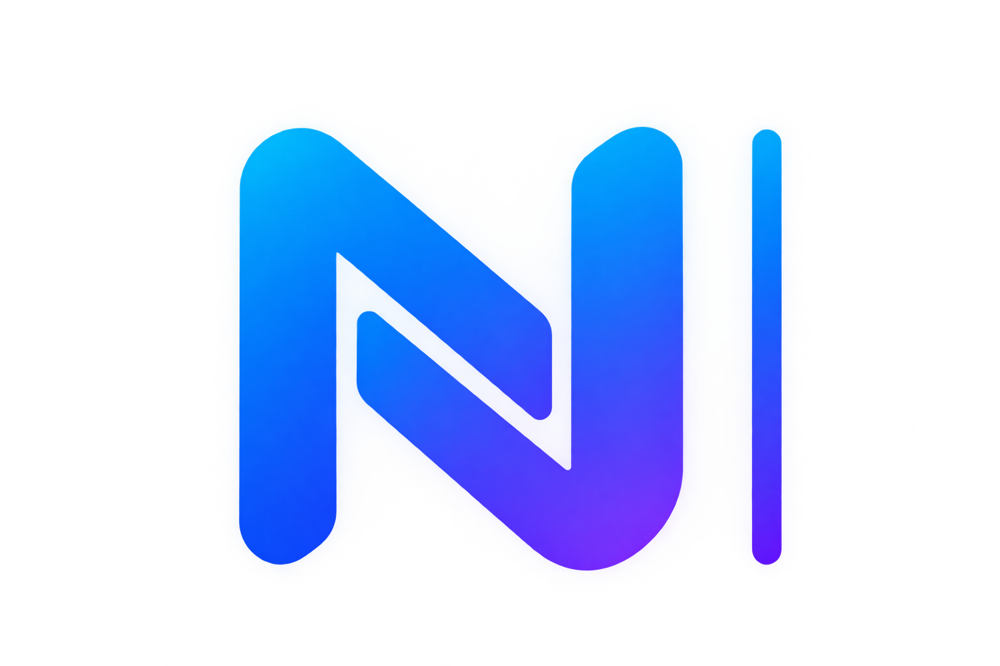

 

# ¡Hola! Soy Carlos Nicolás Basualdo 👋

### JUNIOR SOFTWARE DEVELOPER

Técnico Superior en Desarrollo de Software, orientado al desarrollo web.

---

## 👨‍💻 Sobre mí

|                                                                                                                                                                                                                                                                                                                                                                  |
| :--------------------------------------------------------------------------------------------------------------------------------------------------------------------------------------------------------------------------------------------------------------------------------------------------------------------------------------------------------------- |
| Me interesa especialmente el desarrollo web, tanto en el frontend como en el backend. Trabajo en proyectos personales para aplicar mis conocimientos, mejorar mis habilidades y seguir aprendiendo nuevas tecnologías. Actualmente, busco mi **primera oportunidad laboral en desarrollo de software**, donde pueda aportar, aprender y crecer profesionalmente. |

---

## 🛠️ Tecnologías y herramientas

|                              **Frontend**                               |                   **Backend y bases de datos**                    |                             **Herramientas**                             |
| :---------------------------------------------------------------------: | :---------------------------------------------------------------: | :----------------------------------------------------------------------: |
|  |  |  |

---

                                                              |

## 🚀 Proyectos destacados

### 🎬 CineFamily

Aplicación web para la gestión y reserva de entradas de cine. Incluye funciones, salas, selección de asientos, reservas, carrito de snacks y generación de entradas en PDF.

**Tecnologías:** Django · React · PostgreSQL · Docker

  <a href="https://github.com/CNBasualdo/CineFamily">Ver repositorio de CineFamily →</a>

---

### 🛍️ 404Shop

Tienda online de indumentaria con catálogo, filtros, detalle de productos, variantes de talles, control de stock y carrito de compras.

**Tecnologías:** Django REST Framework · React · PostgreSQL · Docker

  <a href="https://github.com/CNBasualdo/404Shop">Ver repositorio de 404Shop →</a>

---

## 📫 Contacto

Estoy abierto a oportunidades laborales y a conectar con personas del mundo del desarrollo de software.

<table align="center">
  <tr>
    <td align="center" width="140">
      <a href="https://portfolio-c-nicolas-basualdo.vercel.app/">
        
         
        <strong>Portafolio</strong>
      </a>
    </td>
    <td align="center" width="140">
      <a href="https://www.linkedin.com/in/carlosnbasualdo233/">
        
         
        <strong>LinkedIn</strong>
      </a>
    </td>
  </tr>
</table>

 

---

  
   
  <i>Gracias por visitar mi perfil.</i>

